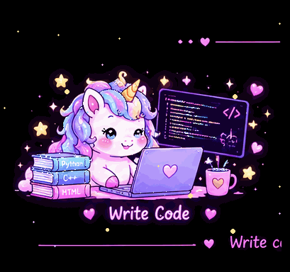

<!-- 🦄━━━━━━━━ HELLO ━━━━━━━━🦄 -->

  

<h1 align="center">
  🦄 My Magical World 💗
</h1>

  ✨ Learning • Coding • Creating ✨

  

<!-- 🌸 ABOUT ME -->

<h2 align="center">🌸 About Me</h2>

  Hi! I'm Sama 👋💗
   
  I'm learning programming, electronics, and electrical circuits.
   
  I enjoy exploring how software and hardware work together.

  🌱 Learning every day
   
  💡 Exploring new ideas
   
  ⚡ Building my technical skills step by step

  

<!-- 💻 MY SKILLS -->

<h2 align="center">💻 Languages & Technologies</h2>

  
  
  
  

  🔌 Electronic Components &nbsp; • &nbsp; ⚡ Electrical Circuits
   
  🐍 Python &nbsp; • &nbsp; 💻 C++

<!-- 🌷 ALWAYS LEARNING -->

<h2 align="center">🌱 Always Learning</h2>

  <i>
    Learning, experimenting, solving problems,
    and improving one step at a time.
  </i>

  🌸 ✨ 🦄 ✨ 🌸

  

<!-- 📊 GITHUB DASHBOARD -->

<h2 align="center">📊 My GitHub Dashboard</h2>

  <i>✨ A little progress every day adds up to big results ✨</i>

<!-- GitHub Stats -->

  
  

<!-- Contribution Streak -->

<h3 align="center">🔥 My Coding Streak</h3>

  

<!-- Contribution Graph -->

<h3 align="center">🌷 My Contribution Journey</h3>

  

<!-- Extra Stats -->

  
💗 ✨ Explore More GitHub Stats

   

  

    
  

  

    
    
  

  

    
    
  

<!-- 🦄 MY CODE CYCLE -->

  

<h2 align="center">🦄 My Code Cycle</h2>

<!-- Write Code GIF -->

  

<!-- Coding Unicorn GIF -->

  

  💻 Write Code &nbsp; ✨ &nbsp;
  🔍 Find Bugs &nbsp; ✨ &nbsp;
  🛠️ Fix Bugs &nbsp; ✨ &nbsp;
  🔁 Repeat!

<!-- 💖 FOOTER -->

  

  💗 Keep Learning
  &nbsp; ✨ &nbsp;
  Keep Coding
  &nbsp; 🦄 &nbsp;
  Keep Dreaming 💗

  ✨ Thanks for visiting my magical world! ✨

