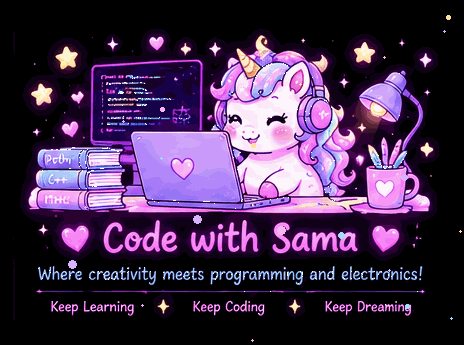
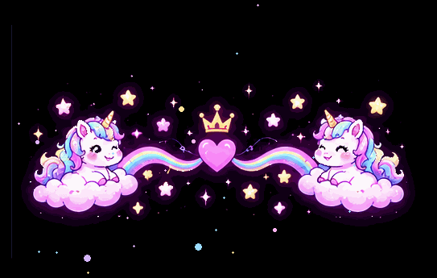

<!-- 🦄 Hello Banner -->

  

<h1 align="center">Welcome to My Magical World! 🦄</h1>

  

<h2 align="center">Code with Sama 💗</h2>

  <i>Where creativity meets code, electronics, and engineering!</i>

  💗 Keep Learning &nbsp; ✨ &nbsp; Keep Coding
  &nbsp; 🦄 &nbsp; Keep Dreaming

  

<!-- 🌸 About Me -->
<h2 align="center">🌸 About Me</h2>

  Hi! I'm Sama, a learner passionate about programming,
  electronics, and electrical circuits.

  I'm building my skills step by step through learning,
  experimenting, and solving practical problems.

  💻 Programming &nbsp; | &nbsp;
  ⚡ Electronics &nbsp; | &nbsp;
  🔌 Electrical Circuits

<!-- 💻 Coding Journey -->

  

<h2 align="center">💻 My Coding Journey</h2>

  
  
  
  

  <i>Exploring the connection between software and hardware,
  one step at a time.</i>

<!-- ✨ Interests -->
<h2 align="center">✨ My Interests</h2>

  🔌 Electronic Components
   
  ⚡ Electrical Circuits
   
  💻 Programming with Python and C++
   
  🛠️ Practical Engineering and Problem Solving

  

<!-- 📊 GitHub Stats -->
<h2 align="center">📊 My GitHub Stats</h2>

  
  

  
💗 More GitHub Stats

  

    
  

  

<!-- 🦄 My Code Cycle -->
<h2 align="center">🦄 My Code Cycle</h2>

  

  <i>Write Code ✨ Find Bugs ✨ Fix Bugs ✨ Repeat!</i>

<!-- 🌈 Footer -->

  

<h3 align="center">Thanks for Visiting! 💗</h3>

  <i>Keep learning, keep creating, and never stop dreaming.</i>

  💗 ✨ 🦄 ✨ 💗

  
